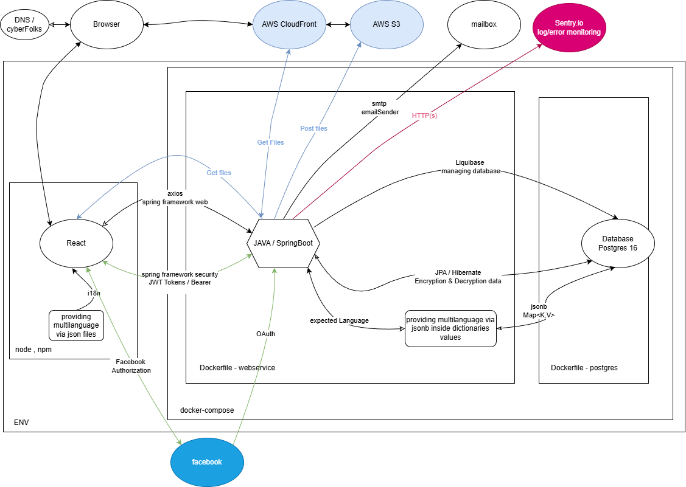

# ZapiszTo

### Full-Stack Web Application

A full-stack application built with **Java, Spring Boot, React and TypeScript**, designed with a REST API architecture and a separate frontend and backend.

The project demonstrates practical experience in backend development, database integration, authentication, API design and modern frontend development.

---

## Tech Stack

### Backend
- Java 17
- Spring Boot
- Spring Security
- Spring Data JPA / Hibernate
- REST API
- PostgreSQL
- Maven
- JWT Authentication
- OAuth2

### Frontend
- React
- TypeScript
- JavaScript
- HTML5 / CSS3
- Axios
- React Hooks
- React i18next

### Infrastructure & Tools
- Docker
- Microsoft Azure
- AWS (S3, CloudFront)
- Git
- npm / Yarn
- Capacitor (Android)

---

## Architecture

The application follows a client-server architecture, separating the frontend from the backend.

```text
                  ZAPISZTO
                     |
          +----------+----------+
          |                     |
       Frontend              Backend
          |                     |
    React + TypeScript      Java 17
          |                Spring Boot
          |                     |
          +------ REST API -----+
                                |
                         Spring Security
                                |
                         Spring Data JPA
                                |
                            Database
                           PostgreSQL
```
<p align="center">
  
</p>

### Backend

The backend is built using Spring Boot and provides REST endpoints responsible for application logic, data processing and communication with the database.

Key technologies:
- Spring Boot application architecture
- RESTful API development
- Entity relationships and persistence with JPA/Hibernate
- Database operations using Spring Data JPA
- Authentication and authorization
- OAuth2 integration
- JWT-based security

### Frontend

The frontend is developed using React and TypeScript.

Key technologies:
- Component-based architecture
- React Hooks
- API integration using Axios
- Type-safe application development
- Authentication flow
- Internationalization using react-i18next

### Mobile

The frontend can also be packaged as an Android application using Capacitor.

---

## Key Features

The application includes functionality related to:

- User authentication and authorization
- REST API communication
- Database-backed application functionality
- Training and exercise management
- Data management and integration
- Responsive web interface
- Android application support

---

## Project Structure

```text
zapiszto/
│
├── backend/
│   ├── src/
│   │   ├── main/
│   │   │   ├── java/
│   │   │   └── resources/
│   │   └── test/
│   └── pom.xml
│
├── frontend/
│   ├── src/
│   ├── public/
│   └── package.json
│
└── README.md
```

*The directory structure may differ depending on the project configuration.*

---

## Getting Started

### Prerequisites

Make sure you have installed:

- Java 17+
- Maven
- Node.js 20+
- npm or Yarn
- PostgreSQL

### 1. Clone the repository

```bash
git clone https://github.com/YOUR_USERNAME/zapiszto-portfolio.git
cd zapiszto-portfolio
```

### 2. Backend configuration

Configure your environment variables according to the provided `.env.example` or application configuration template.

Required configuration may include:

```properties
DATABASE_URL=
DATABASE_USERNAME=
DATABASE_PASSWORD=
JWT_SECRET=
FACEBOOK_CLIENT_ID=
FACEBOOK_CLIENT_SECRET=
```

### 3. Run the backend

```bash
cd backend
mvn clean install
mvn spring-boot:run
```

### 4. Run the frontend

```bash
cd frontend
npm install
npm start
```

*Adjust the frontend start command according to the scripts defined in package.json.*

---

## Security

Sensitive configuration is not included in this repository.

- Credentials are provided through environment variables.
- Secrets and private keys are excluded from version control.
- Production configuration is maintained separately.

---

## Purpose

This project serves as a practical demonstration of full-stack development skills, including:

- Java and Spring Boot backend development
- REST API design and implementation
- Relational database integration
- React and TypeScript frontend development
- Authentication and application security
- Integration of web applications with mobile platforms

---

**Author:** SmykalMateusz

**Repository:** [GitHub](https://github.com/YOUR_USERNAME/zapiszto-portfolio)
